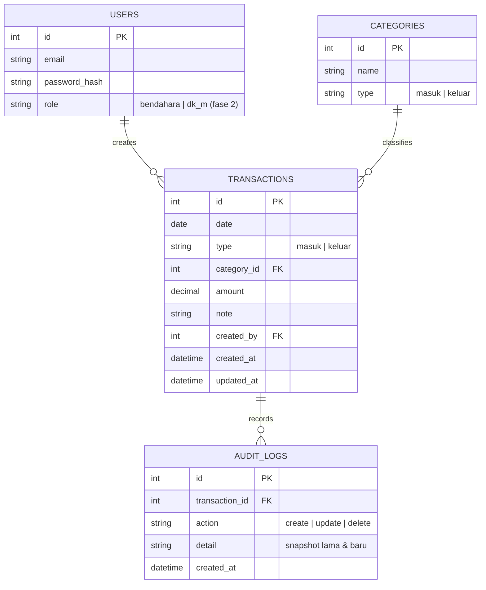

# PRD — Website Pengelolaan Kas Masjid Manbaul Khoir

|                        |                                                                |
| ---------------------- | -------------------------------------------------------------- |
| **Nama Proyek**        | Sistem Pengelolaan Kas Masjid Manbaul Khoir                    |
| **Versi Dokumen**      | v1.0 (Draft)                                                   |
| **Tanggal**            | 21 Oktober 2026                                                |
| **Penulis**            | Junior Web Developer                                           |
| **Target Rilis (MVP)** | 1 bulan sejak development dimulai                              |
| **Status**             | Menunggu konfirmasi pengurus/Pengurus DKM Masjid Manbaul Khoir |

---

## 1. Latar Belakang (Background)

Pengelolaan kas Masjid Manbaul Khoir saat ini masih dilakukan secara manual menggunakan alat tulis dan buku kas. Alur pencatatannya adalah:

1. Mencatat transaksi kas masuk & keluar di **buku kas**.
2. Menginput ulang data dari buku kas ke **Excel**.
3. **Mencetak** laporan Excel.
4. **Menempel hasil cetak di papan pengumuman** (mading) masjid.

Proses ini memiliki beberapa masalah:

- **Kesalahan pencatatan** (salah tulis angka/keterangan) yang harus diperbaiki dengan tipe-x sehingga kurang rapi dan rawan salah baca.
- **Waktu pencatatan lama**: minimal **2–3 jam**, dan bisa lebih jika terjadi kesalahan pencatatan.
- **Pekerjaan dobel**: data ditulis dua kali (buku kas → Excel), meningkatkan risiko selisih angka.
- **Rekapitulasi sulit**: laporan bulanan/tahunan harus dihitung ulang dari catatan harian.
- **Tidak ada salinan digital yang aman**: buku kas dan file Excel bisa rusak/hilang.

## 2. Tujuan (Goals & Objectives)

| No  | Tujuan                                 | Ukuran Keberhasilan (Success Metrics)                                                                                                   |
| --- | -------------------------------------- | --------------------------------------------------------------------------------------------------------------------------------------- |
| 1   | Mempercepat proses pencatatan kas      | Waktu pencatatan turun dari 2–3 jam menjadi **maksimal 15 menit** per sesi input                                                        |
| 2   | Mengurangi kesalahan transkripsi       | Tidak ada lagi koreksi tipe-x; kesalahan entry terdeteksi oleh validasi sistem & bisa diperbaiki lewat edit (audit trail tetap terjaga) |
| 3   | Menghilangkan pekerjaan dobel          | Data cukup diinput **1 kali** di website, laporan cetak dihasilkan otomatis dari data tersebut                                          |
| 4   | Mempermudah penyusunan laporan & audit | Laporan harian (khususnya hari Jumat), bulanan, dan tahunan tersedia **satu klik**, termasuk ekspor PDF/Excel                           |
| 5   | Menjaga keamanan data keuangan masjid  | Backup otomatis berkala **minimal 1x sebulan** + riwayat transaksi penuh (CRUD)                                                         |

## 3. Pengguna & Peran (Users & Roles)

### 3.1 Fase Awal (MVP) — Single User

- **Bendahara Masjid** — satu-satunya akun aktif; menginput, mengedit, menghapus transaksi, melihat dashboard, dan mencetak laporan.

### 3.2 Fase Berikutnya (Pasca-MVP)

| Peran         | Hak Akses                                                               |
| ------------- | ----------------------------------------------------------------------- |
| **Bendahara** | CRUD transaksi, atur kategori & anggaran, cetak laporan                 |
| **Ketua DKM** | Hanya melihat dashboard & laporan, mencetak laporan (read-only + cetak) |

> Catatan: keamanan awal cukup menggunakan **login (email + password)** tanpa MFA, sesuai kesepakatan pengurus.

### 3.3 Perangkat Akses

Website harus **responsive** dan dapat diakses melalui:

- Laptop / Komputer (utama, untuk pencatatan & cetak laporan)
- HP Android (pencatatan cepat & cek saldo)
- Tablet

## 4. Cakupan & Batasan (Scope)

### 4.1 In Scope (MVP)

- Autentikasi login (1 akun Bendahara)
- CRUD transaksi kas masuk & keluar dengan kategori
- Dashboard ringkasan saldo & aktivitas
- Laporan per hari Jumat (prioritas utama), harian, bulanan, tahunan
- Cetak laporan format A4 siap tempel di papan pengumuman
- Ekspor laporan ke PDF dan Excel
- Backup data otomatis berkala (minimal bulanan)
- Riwayat transaksi lengkap (bisa dilihat, diedit, dihapus)

### 4.2 Out of Scope (belum di MVP)

- Multi-role/ multi-akun pengguna → fase berikutnya
- Pembayaran/zakat online (payment gateway) → tidak diminta
- Notifikasi WhatsApp/SMS otomatis
- Fitur offline-first (keputusan: selalu membutuhkan internet)
- Manajemen anggaran/program kerja → **prioritas menengah**, diusulkan masuk fase 2

## 5. Fitur (Fitur Requirements)

### Prioritaskan dengan MoSCoW:

| Prioritas       | Fitur                              | Keterangan                                                                                  |
| --------------- | ---------------------------------- | ------------------------------------------------------------------------------------------- |
| **Must Have**   | Login Bendahara                    | Satu akun, proteksi route, session/JWT                                                      |
| **Must Have**   | Transaksi Kas Masuk & Keluar       | Form input cepat: tanggal, kategori, jenis (masuk/keluar), nominal, keterangan              |
| **Must Have**   | Kategori Transaksi                 | Kategori bawaan sesuai kebutuhan masjid (lihat §5.1)                                        |
| **Must Have**   | Dashboard Ringkasan                | Saldo saat ini, total kas masuk/keluar bulan berjalan, transaksi terakhir, grafik sederhana |
| **Must Have**   | Laporan Hari Jumat                 | Rekap khusus Jumat: infaq kotak amal & amplop Jumat                                         |
| **Must Have**   | Laporan Harian / Bulanan / Tahunan | Filter tanggal, total per kategori, saldo akhir                                             |
| **Must Have**   | Cetak Laporan A4                   | Format siap tempel papan pengumuman: header masjid, tabel transaksi, total, tanda tangan    |
| **Must Have**   | Backup Data Otomatis               | Dump database otomatis minimal 1x/bulan, bisa di-download                                   |
| **Should Have** | Ekspor PDF & Excel                 | Selain cetak langsung dari browser                                                          |
| **Should Have** | Riwayat & Audit Trail              | Setiap edit/hapus transaksi tercatat siapa & kapan                                          |
| **Could Have**  | Manajemen anggaran / program kerja | Fase 2                                                                                      |
| **Could Have**  | Multi-role (DKM read-only)         | Fase 2                                                                                      |

### 5.1 Kategori Transaksi Bawaan (Seed Data)

**Kas Masuk:**

- Infaq Kotak Amal
- Infaq Amplop Jumat
- Infaq Pengajian Ibu-Ibu
- Zakat Maal
- Zakat Fitrah
- Infaq Idul Fitri
- Infaq Idul Adha
- Sedekah / Lain-lain (bebas)

**Kas Keluar:**

- Kebersihan & Keamanan
- Utilitas (listrik, air, internet)
- Sumbangan / Santunan
- Perawatan / Renovasi
- Operasional Kegiatan / Program Kerja
- Lain-lain (bebas)

> Kategori bersifat dapat ditambah/diubah/dihapus oleh Bendahara.

### 5.2 User Stories (MVP)

| ID    | Sebagai... | Saya ingin...                                                                          | Agar...                                                       |
| ----- | ---------- | -------------------------------------------------------------------------------------- | ------------------------------------------------------------- |
| US-01 | Bendahara  | Login dengan email & password                                                          | Data kas hanya bisa diakses pengurus berwenang                |
| US-02 | Bendahara  | Menambah transaksi masuk/keluar dengan memilih kategori & mengisi nominal              | Pencatatan cepat tanpa tulis manual ganda                     |
| US-03 | Bendahara  | Melihat saldo terkini & ringkasan bulan berjalan di dashboard                          | Tahu posisi kas masjid kapan saja                             |
| US-04 | Bendahara  | Melihat rekap transaksi khusus hari Jumat                                              | Mempermudah laporan mingguan infaq Jumat                      |
| US-05 | Bendahara  | Memfilter & mencetak laporan periode tertentu (harian/bulanan/tahunan) dalam format A4 | Langsung ditempel di papan pengumuman tanpa input Excel ulang |
| US-06 | Bendahara  | Mengedit/menghapus transaksi yang salah catat                                          | Memperbaiki kesalahan entry tanpa tipe-x                      |
| US-07 | Bendahara  | Melihat riwayat transaksi lengkap beserta perubahan terakhir                           | Menjaga akuntabilitas & kemudahan audit pengurus              |
| US-08 | Bendahara  | Mengunduh/menerima backup data berkala                                                 | Data aman meski terjadi kegagalan server                      |

## 6. Kebutuhan Fungsional (Functional Requirements)

| ID    | Kebutuhan                                                                                                                                                    |
| ----- | ------------------------------------------------------------------------------------------------------------------------------------------------------------ |
| FR-01 | Sistem wajib mengautentikasi pengguna sebelum mengakses halaman transaksi & laporan                                                                          |
| FR-02 | Transaksi memiliki field: `id, tanggal, jenis (masuk/keluar), kategori, nominal (Rp), keterangan, created_at, updated_at, created_by`                        |
| FR-03 | Setiap transaksi dapat dibuat, dibaca, diedit, dan dihapus (CRUD) oleh Bendahara                                                                             |
| FR-04 | Saldo dihitung otomatis: `saldo = total kas masuk − total kas keluar` sampai tanggal berjalan                                                                |
| FR-05 | Laporan tersedia dengan filter: rentang tanggal, kategori, jenis (masuk/keluar)                                                                              |
| FR-06 | Laporan khusus **Jumat** menampilkan rekap infaq Kotak Amal & Amplop Jumat untuk rentang tanggal yang dipilih                                                |
| FR-07 | Halaman cetak menggunakan template A4 berisi: kop/masjid, judul laporan, periode, tabel transaksi, ringkasan total, kolom tanda tangan Bendahara & Ketua DKM |
| FR-08 | Laporan dapat diekspor ke **PDF** dan **Excel (.xlsx)**                                                                                                      |
| FR-09 | Sistem melakukan backup database otomatis **minimal 1x dalam 30 hari** dan menyimpan riwayat backup                                                          |
| FR-10 | Semua perubahan pada transaksi (create/update/delete) tercatat sebagai riwayat audit                                                                         |

## 7. Kebutuhan Non-Fungsional (Non-Functional Requirements)

| Aspek            | Kebutuhan                                                                                                   |
| ---------------- | ----------------------------------------------------------------------------------------------------------- |
| **Performa**     | Halaman utama dimuat < 3 detik; input transaksi < 2 detik setelah submit                                    |
| **Responsif**    | Tampilan optimal di Laptop, HP Android, dan Tablet (mobile-first untuk form input)                          |
| **Keamanan**     | Login wajib; password di-hash; proteksi route sisi client & server; validasi input di server                |
| **Ketersediaan** | Online 24/7 (membutuhkan internet sesuai keputusan pengurus)                                                |
| **Backup**       | Otomatis minimal bulanan; dapat dipulihkan (restore) bila diperlukan                                        |
| **Usability**    | Antarmuka sederhana dalam Bahasa Indonesia; bendahara non-IT harus bisa menggunakan tanpa pelatihan panjang |
| **Skala Data**   | Mendukung transaksi tahunan (ribuan baris) tanpa penurunan performa signifikan                              |

## 8. Arsitektur & Alur Kerja Teknis

### 8.1 Stack Teknologi (sesuai preferensi developer)

| Layer    | Teknologi                                                                 |
| -------- | ------------------------------------------------------------------------- |
| Frontend | **Next.js (App Router) + TypeScript + Axios** → deploy di **Vercel**      |
| Backend  | **Express.js + TypeScript** → deploy di **Vercel (Serverless Functions)** |
| ORM      | **Prisma**                                                                |
| Database | **PostgreSQL (Supabase)**                                                 |

> Catatan: Railway tidak digunakan karena limit free tier hanya 30 hari; backend Express akan dikonfigurasi sebagai serverless functions di Vercel. Alternatif jika ada kendala kompatibilitas: Next.js Fullstack (Route Handlers) di Vercel.

### 8.2 Alur Data

```mermaid
flowchart LR
    A[Bendahara input transaksi<br/>(Laptop/HP/Tablet)] --> B[Frontend Next.js<br/>Vercel]
    B --> C[Backend Express API<br/>Vercel Serverless]
    C --> D[(PostgreSQL<br/>Supabase)]
    C --> E[Laporan & Cetak A4<br/>(PDF/Excel)]
    D --> F[Backup otomatis<br/>minimal 1x/bulan]
    E --> B
```

### 8.3 Rancangan Model Data (Awal)



## 9. Laporan & Format Cetak (Kebutuhan Spesifik Papan Pengumuman)

- **Ukuran kertas**: A4, orientasi potrait.
- **Header**: Nama Masjid Manbaul Khoir, judul laporan (mis. "LAPORAN KEUANGAN PERIODE …"), periode cetak.
- **Isi**: Tabel transaksi (tanggal, kategori, keterangan, kas masuk, kas keluar) + baris ringkasan (total masuk, total keluar, saldo akhir).
- **Footer**: Kolom tanda tangan **Bendahara** & **Ketua DKM**, tanggal cetak.
- **Khusus laporan Jumat**: rekap infaq kotak amal & amplop Jumat siap tempel tiap minggu.

## 10. Milestone (Target 1 Bulan)

| Minggu       | Deliverable                                                                                                         |
| ------------ | ------------------------------------------------------------------------------------------------------------------- |
| **Minggu 1** | Setup monorepo (Next.js + Express + Prisma + Supabase), desain database & migration, login Bendahara, CRUD kategori |
| **Minggu 2** | CRUD transaksi masuk/keluar, validasi input, halaman dashboard ringkasan saldo                                      |
| **Minggu 3** | Modul laporan (harian, khusus Jumat, bulanan, tahunan), template cetak A4, ekspor PDF/Excel                         |
| **Minggu 4** | Backup otomatis, audit trail, uji coba & perbaikan bersama bendahara, deployment final ke Vercel                    |

> Jika lebih cepat: lanjutkan ke fase 2 (multi-role DKM, manajemen anggaran/program kerja).

## 11. Kriteria Penerimaan (Acceptance Criteria — MVP)

- [x] Hanya Bendahara yang login yang dapat mengakses data kas.
- [x] Transaksi masuk/keluar dapat ditambah, diubah, dan dihapus beserta pilihan kategori sesuai daftar §5.1.
- [x] Dashboard menampilkan saldo terkini, total masuk/keluar bulan ini, dan daftar transaksi terakhir.
- [x] Laporan khusus **hari Jumat** tersedia dan menampilkan rekap infaq kotak amal & amplop Jumat.
- [x] Laporan harian/bulanan/tahunan dapat difilter dan dicetak dalam format A4 (kop masjid, tabel, total, tanda tangan).
- [x] Laporan dapat diekspor ke PDF dan Excel.
- [x] Seluruh pencatatan kas selesai tanpa perlu menulis ulang ke buku kas/Excel (proses ≤ 15 menit).
- [x] Riwayat transaksi (audit trail) menampilkan riwayat perubahan.
- [x] Backup database terjadwal otomatis minimal 1x dalam 30 hari.

## 12. Asumsi & Risiko

| No  | Asumsi / Risiko                                                                                    | Mitigasi                                                                                 |
| --- | -------------------------------------------------------------------------------------------------- | ---------------------------------------------------------------------------------------- |
| 1   | Backend Express di Vercel sebagai serverless functions memiliki keterbatasan (cold start, runtime) | Siapkan fallback: pindah ke **Next.js Route Handlers** (tetap Vercel) bila kendala besar |
| 2   | Database Supabase (free tier) memiliki limit                                                       | Monitoring pemakaian; backup rutin agar data aman bila perlu upgrade                     |
| 3   | Bendahara non-IT perlu adaptasi                                                                    | UI Bahasa Indonesia yang sederhana + sesi demo/sosialisasi singkat                       |
| 4   | Sistem butuh internet (keputusan pengurus)                                                         | Sediakan catatan manual sementara bila mati total; pertimbangkan PWA di fase berikutnya  |
| 5   | Data lama (buku kas/Excel historis) belum terdigitalisasi                                          | Opsional: input saldo awal & data historis penting saat onboarding                       |

---

**Menunggu persetujuan:** PRD ini akan dikonfirmasi dulu ke pengurus DKM Masjid Manbaul Khoir sebelum development dimulai.
